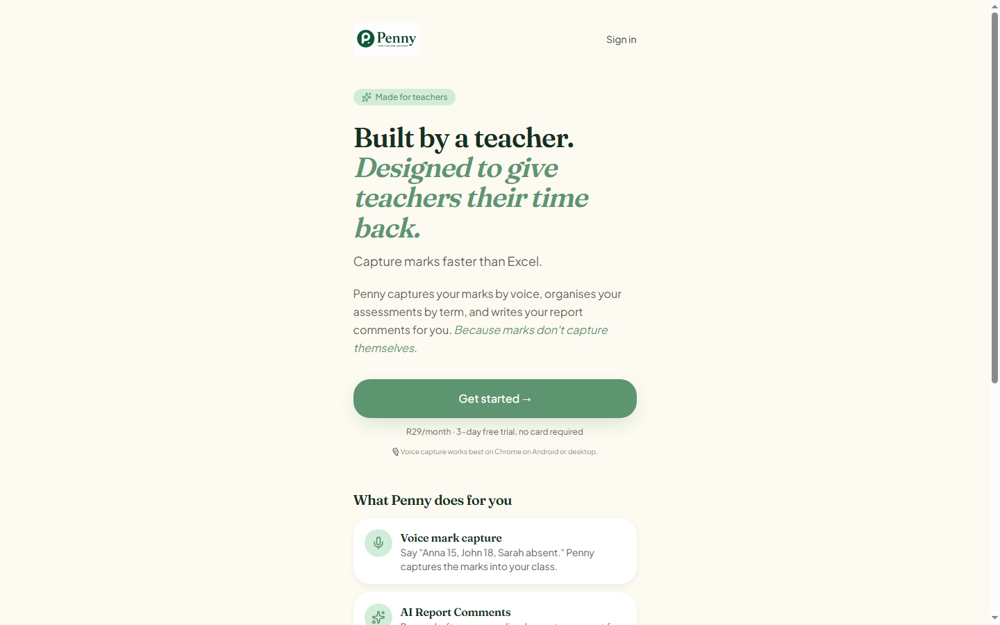

# Penny

**AI teaching assistant for South African classrooms.**

Penny helps teachers capture marks by voice, draft report comments, and send parent messages — built for real classroom workflows, CAPS-aligned contexts, and POPIA-aware data handling.

**Live app:** [app.pennyteacher.co.za](https://app.pennyteacher.co.za)

---

## Screenshot



---

## Features

- **Voice mark capture** — record marks hands-free during lessons
- **Report comments** — AI-assisted, teacher-controlled comment drafting
- **Parent messaging** — transactional email for school–home communication
- **Billing** — PayFast subscriptions for South African payments
- **Prep Check** — AI curriculum planning checker (modular tool)
- **Oral Assessment** — voice viva assessments that verify authentic understanding

---

## Tech stack

| Layer | Technology |
|-------|------------|
| Framework | [TanStack Start](https://tanstack.com/start) + React 19 |
| Routing / data | TanStack Router, TanStack Query |
| Styling | Tailwind CSS 4, Radix UI, shadcn-style components |
| Backend / DB | [Supabase](https://supabase.com) (Auth, Postgres, RLS, Storage) |
| Deploy | Cloudflare Workers via Nitro |
| AI | Google Gemini |
| Email | Resend |
| Payments | PayFast |
| Package manager | [Bun](https://bun.sh) |

---

## Getting started

### Prerequisites

- [Bun](https://bun.sh) (recommended) or Node.js 20+
- A Supabase project
- API keys for Gemini, Resend, and PayFast (as needed)

### Setup

```bash
# Clone
git clone https://github.com/HeavenlyGlowJourneys/penny-teacher.git
cd penny-teacher

# Install
bun install

# Configure environment
cp .env.example .env
# Fill in Supabase, Gemini, Resend, PayFast, and CRON_SECRET values

# Run locally
bun run dev
```

Open the local URL printed by Vite (usually `http://localhost:5173`).

### Scripts

| Command | Purpose |
|---------|---------|
| `bun run dev` | Local development server |
| `bun run build` | Production build (Nitro → Cloudflare Worker) |
| `bun run typecheck` | TypeScript check (`tsc --noEmit`) |
| `bun run lint` | ESLint |
| `bun run format` | Prettier format |

---

## Environment variables

See [`.env.example`](.env.example) for the full list.

**Client (build-time):**

- `VITE_SUPABASE_URL`
- `VITE_SUPABASE_PUBLISHABLE_KEY`
- `VITE_FOUNDER_EMAILS` — comma-separated founder allowlist (not committed; set locally / in CI)

**Server (Worker secrets / `.env` — never commit real values):**

- `SUPABASE_SERVICE_ROLE_KEY` — server database access only. Not accepted as an HTTP bearer.
- `CRON_SECRET` — required `Authorization: Bearer` for scheduled deletion, the email queue, and internal email send.
- `GEMINI_API_KEY`
- `RESEND_API_KEY` / `RESEND_WEBHOOK_SECRET`
- `PAYFAST_MERCHANT_ID` / `PAYFAST_MERCHANT_KEY` / `PAYFAST_PASSPHRASE`
- `SUPABASE_AUTH_HOOK_SECRET`
- `FOUNDER_EMAILS` — optional server allowlist (falls back to `VITE_FOUNDER_EMAILS`)

On Cloudflare, set secrets with Wrangler:

```bash
npx wrangler secret put SUPABASE_SERVICE_ROLE_KEY
npx wrangler secret put CRON_SECRET
# …repeat for other server secrets
```

---

## Project structure

```
src/
  features/          # Modular product areas (prep-check, oral-assessment, …)
  routes/            # TanStack file-based routes
  components/        # Shared UI
  lib/               # Shared server/client utilities
supabase/
  migrations/        # SQL migrations
```

Private tools live under `src/features/` and can be removed without breaking the core teacher app.

---

## Deploy

```bash
bun run build
npx nitro deploy --prebuilt
```

Health check: `GET /api/healthz`. Returns `200` with `status` of `ok` or `degraded`, or `503` with `status` of `misconfigured`, plus `time`. The body does not name settings or return secret values.

---

## License

Original code and materials in this repository that Heavenly Glow Journeys (Pty) Ltd has the legal right to license are released under the MIT License. See [LICENSE](LICENSE).

Third-party libraries, copied UI components, icons, and other externally licensed materials remain under their own licenses. Heavenly Glow Journeys (Pty) Ltd does not claim ownership of those components. Notices and the items still needing review are in [THIRD_PARTY_NOTICES.md](THIRD_PARTY_NOTICES.md).
